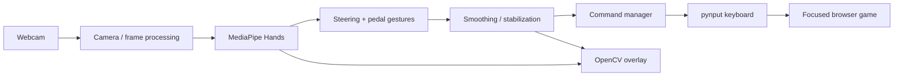
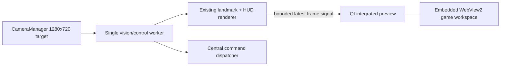

# AI Hand Gesture Racing Controller

A modular Windows computer-vision controller that converts webcam hand motion into
keyboard controls for an existing browser racing game. The primary profile targets
**Racing Limits on CrazyGames**. This project does **not** recreate, clone, bundle, or
modify Racing Limits.

## Stable v1 and unreleased v2 desktop studio

Version 1.0.0 remains the tagged stable release. The working tree currently contains
the unreleased `2.0.0.dev0` desktop studio: a responsive PySide6 dashboard with the
existing rendered camera/landmark frame integrated directly into a large 16:9 panel,
truthful input-state gauges, and an embedded Microsoft WebView2 game workspace.

The controller requests 1280x720 capture and reports the resolution the device
actually accepts. The processing copy may be smaller for low-latency inference; this
does not reduce capture resolution. Qt uses smooth aspect-preserving display scaling
and never stretches or crops the preview.

Studio Mode places camera and tracking on the left and the embedded game on the right.
Camera Focus expands diagnostics; Compact Controller leaves more room for gameplay.
Window geometry and the selected layout are stored per user.

On Windows, `auto` uses the installed Microsoft WebView2 Runtime. Racing Limits was
validated through its playable tutorial with WebGL, mouse input, keyboard input, and
audio. If the runtime or optional adapter is unavailable, the workspace reports the
actual reason and offers **Open Externally**. Qt WebEngine is not selected for Racing
Limits because the distributed Qt build cannot decode the game's MP4A audio buffers;
Unity treats those failures as fatal.

## Production vision engine

The production vision engine negotiates an uncropped full camera frame, runs MediaPipe 0.10.21 on an
optional aspect-preserving processing copy, assigns stable spatial steering roles,
persists brief hand loss, smooths palm centers and circular angles, rejects implausible
jumps, and uses hysteresis for direction changes. Part 2 adds staged webcam calibration,
a role-aware steering-wheel HUD, and rolling capture/inference/processing/render timing.

The current adaptive-control release adds One Euro filtering for palm centers, wrists,
and circular steering angles. Movement speed automatically adjusts smoothing: slow
hands receive stronger stabilization while fast turns remain responsive. Tracking
confidence gates unsafe updates, and continuous response curves replace fixed linear
output.

> Safety first: dry-run is the default. Real keyboard automation starts only with
> `--live`. Keep the preview visible and press **Q** or **Esc** to stop.

## Features

- OpenCV capture and MediaPipe Hands detection
- Full-frame backend/resolution negotiation with uncropped, aspect-safe preview scaling
- Two-hand virtual-wheel steering with calibration, inversion, dead zone, and smoothing
- Hybrid pedal recognition: a relaxed closed fist accelerates and a naturally open
  palm brakes; ML only assists ambiguous/additional gestures
- Frame-based command debounce and tracking-loss release timeout
- Exact keyboard state management with no duplicate presses and unconditional cleanup
- Dry-run preview, landmarks, angle, commands, keys, FPS, latency, screenshots, recording
- YAML profiles/configuration, calibration persistence, rotating logs, tests, and CI



The dependency boundary is deliberate: gesture code emits abstract commands; only
`src/controller/` can emit keyboard events.



## Desktop studio

```powershell
python gui.py
```

Start with **Controller Test**, which never emits gameplay keys. **Start LIVE** retains
the explicit warning and uses the same central dispatcher as the CLI. **Stop**,
**Emergency Stop**, tracking loss, camera failure, and application shutdown release
active keys. The integrated preview is the normal GUI path; the standalone OpenCV
window remains available to CLI/diagnostic workflows.

The default game URL is `https://www.crazygames.com/game/racing-limits`. Game
compatibility depends on the site accepting the configured keyboard input. Click or
use **Focus** in the embedded toolbar before LIVE control. The application does not read vehicle speed,
RPM, gear, or any other game telemetry; the dashboard displays only controller input
state it actually knows.

## Requirements and Windows installation

Use 64-bit Python 3.11, a webcam, Windows 10/11, and a browser. The legacy MediaPipe
Solutions integration is pinned to `mediapipe==0.10.21`.

```powershell
py -3.11 -m venv .venv
.venv\Scripts\Activate.ps1
python -m pip install --upgrade pip
pip install -r requirements.txt
python scripts/check_dependencies.py
python scripts/check_camera.py
```

If activation is blocked, run `Set-ExecutionPolicy -Scope Process RemoteSigned`, then
activate again. The setting applies only to that PowerShell process.

## Calibrate and run

The optional calibrator shows the webcam and guides camera validation, neutral, left,
right, comfortable distance, open palm, closed fist, and review stages. Hold each pose
steadily, press Space to collect,
R to retry the current stage, Q/Esc to cancel, and S to save at review.

```powershell
python scripts/calibrate_controller.py --force
python run.py --dry-run --calibration data/calibration/default.yaml
```

If the webcam cannot open, the script offers an explicit manual fallback. It never
silently saves default values. Use `--manual` to request that mode directly.

Open Racing Limits in CrazyGames, manually verify its keyboard controls, click the game
so its browser window has focus, then explicitly enable keyboard output:

```powershell
python run.py --live --calibration data/calibration/default.yaml
```

Other examples:

```powershell
python run.py --help
python run.py --camera-index 1 --dry-run
python run.py --record --dry-run
python run.py --no-preview --dry-run
python run.py --config config/default_config.yaml --profile config/racing_limits.yaml
python run.py --record-session --dry-run
python run.py --replay-session output/session_recordings/session_YYYYMMDD_HHMMSS
```

`--no-preview` must be stopped with Ctrl+C. Preview mode also supports **P** for a
screenshot. **S** is the preferred screenshot shortcut. Recording is optional and a writer failure disables recording without
disabling control.

During a session, press **1**, **2**, or **3** to hot-switch Easy, Normal, or Pro
steering. Filtering retains its state during switching, so there is no reset jump.

## Adaptive steering configuration

`config/steering_profiles.yaml` defines:

- dead zone and maximum steering angle;
- linear, cubic, exponential, or sigmoid response curve;
- response-curve strength;
- One Euro minimum cutoff and speed coefficient (`beta`).

Easy emphasizes stability, Normal balances precision and response, and Pro uses a
smaller dead zone with faster filtering. `config/default_config.yaml` selects the
initial profile and exposes palm/wrist and angle filter settings, minimum gesture
confidence, diagnostic interval, and session output locations.

One Euro tuning follows two practical rules:

- lower `min_cutoff` produces stronger slow-motion smoothing;
- higher `beta` releases smoothing more aggressively during fast motion.

No frame queue or background worker is used. Processing stays synchronous and bounded,
which avoids stale-frame latency. Lower `camera.processing_width` first when inference
is the bottleneck. Camera recommendations in the HUD use measured FPS, latency,
brightness, actual resolution, and backend.

## Session diagnostics

`--record-session` stores rendered HUD video, synchronized JSONL telemetry, and metadata
under `output/session_recordings/`. Telemetry contains timestamps, raw/calibrated/
smoothed steering, curved normalized output, commands, pedal state, confidence, and
active profile. Replay displays the recorded HUD video exactly as captured.

Every normal controller session writes a constant-memory JSON report beneath
`output/reports/` containing average/minimum FPS, tracking losses, average confidence,
steering variance, runtime, profile, and camera information.

## Multi-camera and virtual cameras

Camera sources are configured in `camera.sources`. Local/USB cameras and OBS Virtual
Camera use numeric indices. DroidCam and IP Webcam use an explicitly supplied local
stream URL and the default OpenCV backend. Disabled or blank network entries are never
contacted. Set `automatic_detection` to probe local indices, press **C** to hot-switch,
and the last successful source is remembered in `data/camera_state.json`. Disconnects
trigger bounded reconnect attempts followed by configured-source failover.

No network discovery, cloud call, or telemetry is performed.

## Desktop GUI

```powershell
python gui.py
```

The PySide6 application provides Dashboard, Camera, Calibration, Profiles, Game
Selection, gesture/action mapping, Performance, ML dataset/model tools, Session Replay,
Logs, Configuration, Themes, and About pages. Controller Test is the safe default;
LIVE mode requires an explicit confirmation. Stop, Emergency Stop, window close, Q,
Escape, Ctrl+C, camera failure, and exceptions converge on central key cleanup.
Controller work runs outside the Qt event loop and runtime settings are published over
a thread-safe in-process bus. See [GUI guide](docs/gui_guide.md).

## Game plugins

Built-in declarative profiles cover generic WASD, generic arrow keys, Racing Limits,
Euro Truck Simulator 2, American Truck Simulator, Forza Horizon, and Need for Speed.
These are configurable keyboard templates, not claims of official compatibility. Add games with only
`plugins/<game_id>/game.yaml`; see the [plugin guide](docs/plugin_guide.md). Actual game
key bindings must always be verified in-game.

## Accessibility and optional gestures

Configuration supports mirrored display, left/right-handed selection, single-hand
position steering, and the primary two-hand wheel mode. Optional nitro, horn, pause, and
calibration-reset gestures are disabled by default and use configurable pinch/open-hand
thresholds.

Automatic calibration combines left/right range capture into one controlled motion
stage:

```powershell
python scripts/calibrate_controller.py --automatic --force
```

## Deployment and privacy

PyInstaller, portable ZIP, installer definitions, and CI build verification are
documented in [deployment](docs/deployment.md). Processing is privacy-first and local;
read the [privacy and security policy](docs/privacy.md).

## Controls and configuration

The locked gesture defaults are **closed fist → accelerate**, **open palm → brake**,
and **no hand → release all pedal controls**. Accelerator and brake are mutually
exclusive. The generic Arrow profile uses Up=accelerate, Down=brake/reverse and
Left/Right=steering; the safe first-run profile is generic WASD.
Actual controls are owned by the browser game and must be manually verified. To use
WASD, edit `config/racing_limits.yaml`:

```yaml
key_mapping:
  accelerate: w
  brake: s
  left: a
  right: d
```

The primary steering mode uses smoothed palm centers as wheel grips. Tilting their
connecting line steers. Deterministic, normalized finger geometry gives basic pedals
one-frame response; state-aware frame hysteresis ignores isolated noise. One-hand
steering is disabled by default because it can produce unsafe direction changes. Tune
thresholds, camera properties, smoothing, visualization, recording, and tracking
release in `config/default_config.yaml`.

## Quality checks

```powershell
pip install -r requirements-dev.txt
pytest --cov=src --cov-report=term-missing
ruff check .
black --check .
mypy src
```

Tests use synthetic landmarks and mocked keyboard objects: they need no webcam and
emit no real keys.

## Layout

`src/camera` captures frames; `src/hand_tracking` wraps MediaPipe; `src/gesture`
produces abstract decisions; `src/smoothing` stabilizes them; `src/controller` alone
owns keyboard effects; calibration, profiles, visualization, performance, recording,
and utilities are separate packages. See [architecture](docs/architecture.md).

Game support is profile-driven through the `GameProfile` protocol. Racing Limits is the
current plugin; future Euro Truck, Forza, or Need for Speed profiles can reuse the
controller pipeline and supply only metadata/key mappings.

## Troubleshooting and limitations

See [installation](docs/installation.md), [controls](docs/controls.md),
[calibration](docs/calibration.md), and [troubleshooting](docs/troubleshooting.md).
Lighting, occlusion, webcam mirroring, and browser focus affect results. Gestures are
threshold-based, not perfectly accurate. Webcam operation and real Racing Limits
gameplay require manual hardware testing; neither is claimed by automated tests.
Software cannot widen a camera's optical field of view. The controller avoids accidental
crop and aspect distortion and reports requested, negotiated, and actual modes, but
1280x720 does not automatically provide wider FOV. Laptop cameras may still require
sitting farther away; an external wide-angle webcam or phone-camera solution can provide
a physically wider view. Bright, even front lighting, a simple contrasting background,
and keeping both palms fully inside the frame materially improve MediaPipe tracking.

Common diagnostics:

- Only one hand: improve lighting, separate overlapping hands, lower processing load,
  and verify both palms are fully visible.
- Flickering: avoid fast motion/occlusion and tune persistence or confidence settings.
- Apparently zoomed camera: compare requested and actual resolution in the camera test;
  the preview never crops, so remaining narrowness is physical/driver FOV.
- Low FPS: reduce `processing_width`, disable recording, or lower capture resolution.
- Calibration failure: keep poses stable and make left/right and pedal poses farther apart.
- MediaPipe Solutions unavailable: recreate the Python 3.11 environment and reinstall
  `requirements.txt`.
- Direct-script import errors: run from the project root; the shared script bootstrap
  removes the need to set `PYTHONPATH`.

## Packaging, contributing, and license

Build the Windows executable with
`python -m PyInstaller --clean --noconfirm packaging/controller.spec`. Bundled
configuration, plugins, trained-model artifacts, documentation, and MediaPipe resources
are resolved independently of the repository and virtual environment. See
[deployment](docs/deployment.md) and [developer guide](docs/DEVELOPER_GUIDE.md).

Contributions must preserve dry-run defaults, centralized keyboard dispatch, unconditional
key release, local-only processing, Python 3.11, and all quality gates. Open an issue or
pull request with tests and a clear manual verification statement. This repository's
license is defined by [LICENSE](LICENSE); no game assets or game software are bundled.

If keys ever appear stuck, focus the terminal and press Ctrl+C, then manually tap and
release the affected key. Every normal, Q/Esc, Ctrl+C, tracking-loss, and exception
shutdown path invokes release-all.

Future enhancements are listed separately in [future scope](docs/future_scope.md).
Licensed under the [MIT License](LICENSE).
# Machine-learning gesture engine

The locked basic pedal mapping is **closed fist → accelerate** and
**open palm → brake**. Clear landmark gestures act on the first processed frame;
ML is reserved for genuinely ambiguous poses.

Version 5 adds an optional, local machine-learning path for discrete hand gestures. The
existing two-hand steering geometry, calibration, camera management, recording, replay,
game plugins, and rule-based gesture detector remain available. ML inference is disabled
by default and automatically falls back to the rule-based detector if model artifacts are
missing or incompatible.

The processing path is:

```text
Camera -> MediaPipe landmarks -> normalized geometric features
       -> trained classifier -> confidence gate -> temporal vote
       -> editable action mapping -> existing CommandManager
```

Features use 21 relative landmark coordinates plus finger joint angles, fingertip
distances, extension states, hand openness, palm orientation, and wrist orientation.
Translation, hand scale, and in-plane rotation are normalized before inference.

## Dataset and training

Record one gesture class at a time (show exactly one hand):

```powershell
python scripts/record_gesture_dataset.py open_palm --sample-count 100
python scripts/record_gesture_dataset.py closed_fist --sample-count 100
```

The recorder counts down, draws landmarks, captures automatically, rejects duplicate
feature rows, validates the requested sample count, and exits safely with Q, Esc, or
Ctrl+C. Use `--export data/exports/my_dataset` to create a dataset manifest and checksum.

Train and evaluate all supported classifiers:

```powershell
python scripts/train_gesture_model.py
```

Training uses a deterministic stratified holdout, cross-validation, and bounded
hyperparameter searches for Random Forest, SVM, KNN, and Logistic Regression. It writes
the selected model, reproducibility metadata, accuracy/precision/recall/F1,
classification report, and confusion matrix under `models/trained/`.

Enable inference only after reviewing evaluation output:

```yaml
machine_learning:
  enabled: true
  confidence_threshold: 0.65
  smoothing_window: 5
```

Edit `config/gesture_actions.yaml` to bind labels to abstract game commands. Mappings
continue through the existing game profile, conflict handling, dry-run protection, and
emergency key release. All training and inference remain on the local machine; no images,
features, or metrics are transmitted.

For reliable results, collect each class under varied lighting, hand positions, distances,
and backgrounds while keeping class counts balanced. A high validation score on samples
from one recording session does not guarantee generalization to a different user or
camera. See [the ML gesture guide](docs/ml_gestures.md) for dataset and tuning details.
